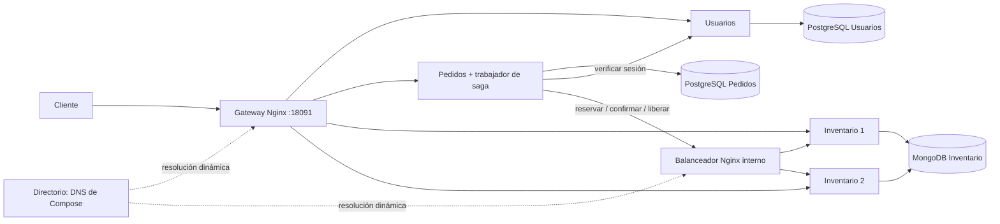

# Decisiones de arquitectura

Versión distribuida ejecutada y probada el 6 de noviembre de 2026, rama `02-separacion`. `01-monolito` conserva la compra atómica inicial para contrastar el costo de distribuirla.

| Decisión | Implementación | Beneficio y costo |
| --- | --- | --- |
| Fronteras | Usuarios, Inventario y Pedidos; cada servicio accede solo a su propia base | Autonomía a cambio de fallas parciales y contratos HTTP |
| Entrada | Nginx; rutas públicas `/api/usuarios`, `/api/sesiones`, `/api/productos`, `/api/pedidos` | Un puerto; gateway único es un punto de falla |
| Directorio | DNS de Compose; Nginx 1.27.5 con resolver, `zone` y `resolve` | Resuelve cambios de dirección tras reinicios; depende del host y DNS |
| Balanceo | Round robin Nginx a dos réplicas de Inventario, en entrada y llamadas internas | Ocho lecturas verificaron ambas instancias con `X-Instancia`; no prueba escalabilidad ni HA de Mongo |
| Datos | PostgreSQL exclusivo por Usuarios/Pedidos; MongoDB para productos y reservas embebidas | Transacciones locales y reserva de un producto atómica; se pierde la transacción global |
| Operaciones | Saga orquestada persistida en Pedidos; reserva/confirmación/liberación idempotentes | Reanuda tras reinicio; requiere estados intermedios y conciliación |
| Fallas | Timeouts conexión 1 s / lectura 3 s hacia Inventario; CB tras tres fallas, abierto 10 s, una prueba semiabierta; trabajador con espera 2–30 s | Limita presión; un pedido puede seguir pendiente. No es deadline global ni garantía bajo partición permanente |
| Observación | JSON con servicio, ruta, duración, estado y `trace_id`; mismo identificador en llamadas de la saga | Permite seguir un pedido; no hay recolector, métricas ni OpenTelemetry |

## Invariantes y estados

Stock nunca negativo: la condición `stock >= cantidad`, el descuento y la marca de reserva se escriben juntos en un documento MongoDB. La misma pareja pedido/producto devuelve la reserva previa y no vuelve a descontar. Precio y nombre se congelan en esa reserva.

Un pedido solo llega a CONFIRMADO después de reservar y confirmar todos sus productos. Antes puede estar PENDIENTE, con reservas parciales visibles. Un rechazo de negocio guarda COMPENSANDO antes de liberar; al completar la devolución queda RECHAZADO. Un resultado remoto desconocido conserva el estado recuperable y usa las mismas llaves al reintentar. No se confunde un timeout con rechazo de stock.

El candado de sesión de PostgreSQL serializa trabajadores por pedido, y los commits de progreso son independientes de las llamadas HTTP. Si se pierde la respuesta de una reserva exitosa, repetir el mismo pedido/producto encuentra la marca en MongoDB. Si el proceso muere, el trabajador consulta estados pendientes al arrancar. Si se pierde el almacenamiento de Pedidos, esta garantía ya no aplica.

No se promete consistencia global estricta ni una clasificación CP de toda la aplicación. Se prioriza no confirmar compras sin inventario, sacrificando confirmación inmediata ante incertidumbre. La lectura del catálogo puede cambiar después de responder.

## Evidencia y trabajo del equipo

`evidencia/pruebas-distribuidas.json` contiene las respuestas reales sin tokens. Diez intentos con tres unidades produjeron tres confirmados, siete rechazados y stock cero. Cinco intentos simultáneos con una llave produjeron un pedido y un descuento. Una compra de dos productos recuperó el stock del primero al faltar el segundo. Un pedido sobrevivió al reinicio del orquestador mientras Inventario estaba inaccesible y terminó al recuperarlo.

Trabajo por repartir y revisar con los integrantes: ciclo de sesiones, pruebas de reservas, conciliación/operación de Pedidos y experiencia de demostración. Estos son ámbitos propuestos, no contribuciones ya realizadas. Todos deben explicar el flujo completo y los límites antes de la defensa.

Referencias técnicas: [atomicidad MongoDB](https://www.mongodb.com/docs/manual/core/write-operations-atomicity/), [actualización con pipeline](https://www.mongodb.com/docs/manual/tutorial/update-documents-with-aggregation-pipeline/), [resolución de upstreams Nginx](https://nginx.org/en/docs/http/ngx_http_upstream_module.html#server), [saga](https://microservices.io/patterns/data/saga.html).
